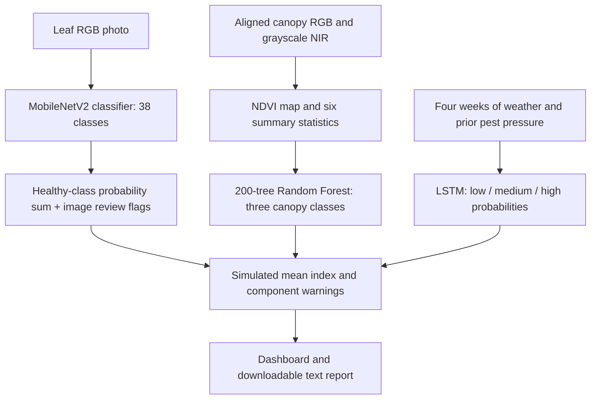

# How CropSenseAI works

CropSenseAI is a crop-health demonstration with three independently trained ML modules in a Streamlit dashboard. It combines a leaf-photo signal, a canopy RGB/NIR signal, and historical pest data to illustrate how separate observations could be presented together. These datasets do not describe the same plant, field, place, and collection time. There is no labelled joint dataset or measured composite accuracy.

## End-to-end flow

The networks and forest are trained separately in Kaggle. The local app loads saved artifacts for inference; launching it does not train the models or fetch live weather/sensor data.

## Code map

| File / symbol | Responsibility |
|---|---|
| `app.py` | Page sections, inputs, local samples, cached resources, session state, visualization, and downloads |
| `app.prepare_image_input`, `core.validate_image` | Decode and validate image boundaries; the UI also limits upload size |
| `app.compute_ndvi_and_stats` | RGB/NIR validation, NDVI statistics, heatmap, and illustrative low-NDVI overlay |
| `app.run_model` | Store inference results, surface errors, and clear failed results |
| `app.clear_disease_input`, `clear_ndvi_input`, `clear_pest_input` | Invalidate results when their source changes |
| `app.apply_scenario` | Load illustrative inputs; does not create a joint dataset |
| `core.predict_disease`, `predict_ndvi`, `predict_pest` | Shared model inference and validated outputs |
| `core.generate_gradcam`, `check_leaf_sanity` | Class-influence overlay and heuristic image screening |
| `core.composite_score`, `composite_assessment`, `generate_report` | Mean arithmetic, component-preserving warning tier, traceable report |
| `core.model_path`, `load_*_model` | Manifest-restricted model resolution and model loading |
| `scripts/release_assets.ensure_local_models` | Verify and restore exact release models from the bundled ZIP |
| `scripts/setup_environment.py`, `prepare_demo.py`, `verify_environment.py` | Machine setup, helper caching, and offline inference checks |

The UI uses Streamlit session state rather than a database. Downloaded reports are generated from the current inputs/results. There is no implemented live ingestion service, user-account backend, or hyperspectral pipeline in this release.

## Module 1: leaf disease

1. Load a leaf RGB photo. `core.preprocess_image` validates and resizes it to **224×224**, producing raw **0–255** values. MobileNetV2 scaling is embedded in the saved graph; applying another external scaling changes the model input.
2. `predict_disease` validates the 38-class probability vector, selects the top class and top alternatives, and optionally generates Grad-CAM.
3. `disease_score` is the sum of probabilities for **all healthy-labelled classes**, rather than one minus the confidence of a disease class.
4. A top probability below **0.5** or an image-screen flag sets `needs_review`. The cutoff is a demo rule. The ImageNet helper and color checks are heuristics, not a trained leaf/crop eligibility detector.

Training data: PlantVillage plus mapped PlantDoc field images in the adaptation work. The locked release has recorded **141/252 (55.95%)** on the retained PlantDoc mirror test examples and **96.83%** on 8,145 PlantVillage validation images. The field set had already been inspected; it is not a new blind evaluation. See [model evaluation](../MODEL_EVALUATION.md) and [recovered CNN records](../evidence/disease-recovery-2026-10-22/README.md).

The classifier has no unknown class and can confidently label unsupported inputs. Grad-CAM shows regions that influence the classifier; it does not establish lesion localization or biological correctness.

## Module 2: canopy stress

1. Supply registered RGB and **8-bit grayscale `L` NIR** images with equal dimensions. Equal dimensions alone cannot prove alignment or sensor calibration. The app rejects color NIR, dimension mismatches, oversized images, and pairs with no usable red/NIR signal.
2. `compute_ndvi_and_stats` uses the RGB red channel and NIR values:

   `NDVI = (NIR - red) / (NIR + red + 1e-8)`

3. Features are **`ndvi_mean, ndvi_std, ndvi_min, ndvi_max, ndvi_p25, ndvi_p75`**, in that order. The forest expects these unscaled values. Manual inputs must satisfy finite values, physical bounds, ordering, and feasible spread.
4. The 200-tree forest returns `healthy`, `moderate_stress`, or `severe_stress`. `core.NDVI_SCORE_MAP` maps them to **1.0, 0.5, 0.1** for the demonstration index. These assigned scores are not calibrated severity measurements.

The Agriculture-Vision labels were derived from anomaly-mask coverage: a selected severe mask above 5% takes precedence; otherwise a selected moderate mask above 2%; otherwise healthy. These are dataset rules, not agronomist diagnoses. The low-NDVI red overlay is a separate visual rule at NDVI < 0.20.

The grouped-field retrained baseline scored **58.42%** on 1,549 test tiles; it is a different model from deployment. Its selected threshold candidate increased severe-to-healthy mistakes and was rejected. The released forest remains unchanged and matches **0/6 healthy**, **6/6 moderate**, and **6/6 severe** bundled fixture labels. Its exact original holdout result remains unverified. See [RF provenance](../evidence/rf-provenance-2026-10-22/README.md).

## Module 3: pest risk

The released LSTM consumes an array of **four weeks × nine features**, in this order:

`MaxT(°C), MinT(°C), RH1(%), RH2(%), RF(mm), WS(kmph), SSH(hrs), EVP(mm), pest_pressure`

The first eight columns are weather measurements; the last is training-scaled prior pest pressure. Weather normalization is inside the graph. A weather-only array or a historical 4×12 experiment does not satisfy the released model contract. Sample metadata is in `models/sample_sequences.json`.

The audit source retrieves ICAR-CRIDA cotton Jassid/Aphid records for Akola, builds windows within seasons, fits scalers/target thresholds on training years, and uses **2005–2007 train, 2008 validation, 2009 test**. This avoids treating future observations as available to a past forecast. The graph outputs probabilities in `low, medium, high` order; expected pest risk is their dot product with **`[0, 0.5, 1]`**.

Recorded test results: **LSTM 10/19 (52.63%)**, persistence **8/19 (42.11%)**, logistic regression **13/19 (68.42%)**. Medium-class recall for the release is **0/5**. This small, already-inspected regional test is insufficient for broad forecasting claims. The app replays saved historical sequences; it does not acquire current pest observations or current weather. See [recovered pest exports](../evidence/pest-export-recovery-2026-10-22/README.md).

## Composite and reports

Let `D` be the healthy-class probability sum, `N` the assigned canopy score, and `P` expected pest pressure. The displayed numeric index is:

`(D + N + (1 - P)) / 3`

`composite_assessment` determines warnings using the **worst component**, with values below 0.33 severe, below 0.66 moderate, and otherwise healthy. A flagged/uncertain leaf gives **Needs review** while preserving component warnings. For example, `D=1, N=0.1, P=0` yields a mean of **0.70**, but the canopy's severe signal is still shown. Bucketing only the mean would hide it.

Reports carry the generation timestamp, available source identifiers/content hashes, model hashes, warnings, and limitations. Generation time does not become sensor acquisition time. Follow-up text asks for confirmation/field review; unverified model output does not justify pesticide or irrigation prescriptions.

## Artifacts and useful checks

`models/artifact_manifest.json` identifies release bytes. The `.keras` and `.pkl` files use Git LFS; `models/release_bundle.zip` is a normal Git file, verified by `release_bundle.sha256`, and contains exact recovery copies. `ensure_local_models` checks both bundle and extracted model hashes. The auxiliary ImageNet model/class-index cache is obtained by setup separately.

| Check | What it covers |
|---|---|
| `tests/test_audit_regressions.py` | Numerical/input boundaries, Grad-CAM forward agreement, reports/warnings, UI failures, stale state, navigation |
| `tests/test_demo_contract.py` | Paired-image statistics, invalid NIR/dimensions, offline LFS-pointer recovery, composite/state behavior |
| `tests/test_training_contract.py` | Field loader records excluded and unknown source folders |
| `test_core.py` through full environment verification | Actual model loads, inference shapes/probabilities, fixture diagnostics, fusion arithmetic, heuristic behavior |
| `scripts/verify_environment.py --offline --full` | Python/package pins, model hashes, reference outputs, cached helper, and blocked socket connections |

Passing these checks establishes the specified runtime contracts. It does not establish field accuracy, biological validity, cross-region performance, or readiness on an untested teammate PC. Use [verification](VERIFICATION.md) for the handoff's actual check results.
