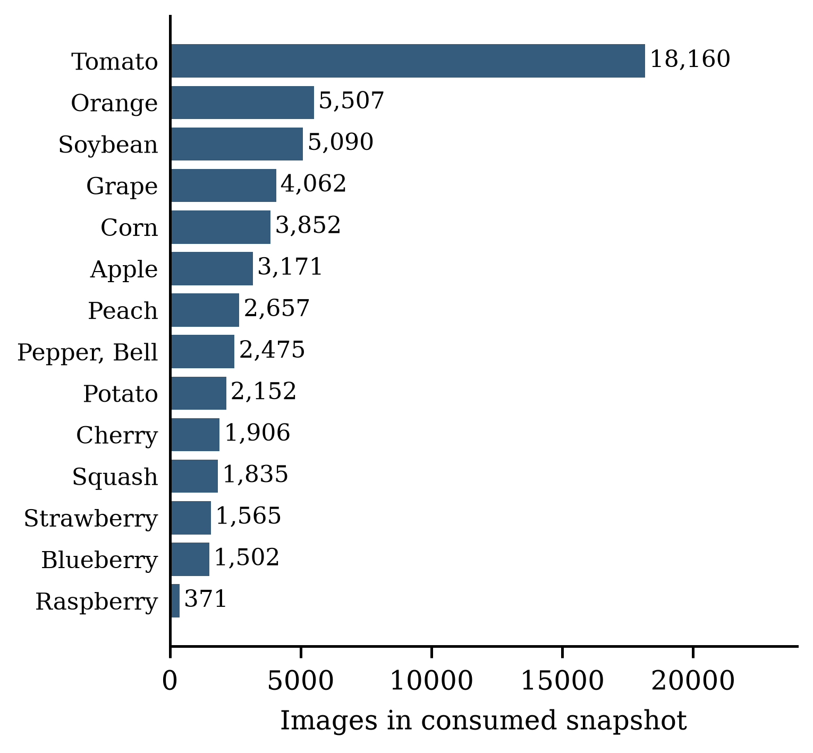
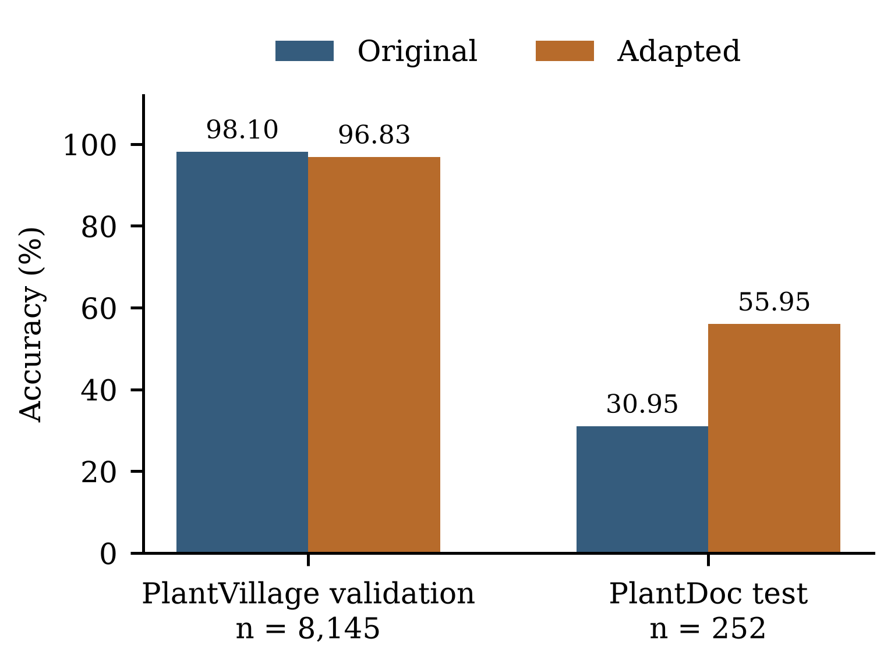
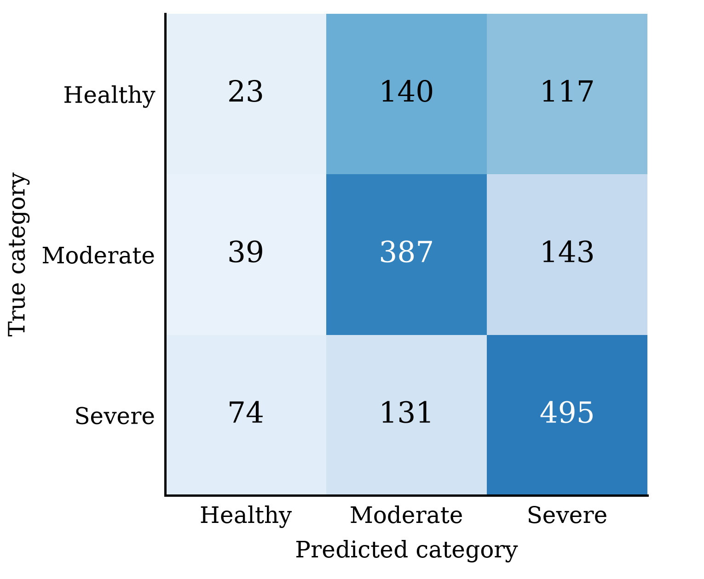
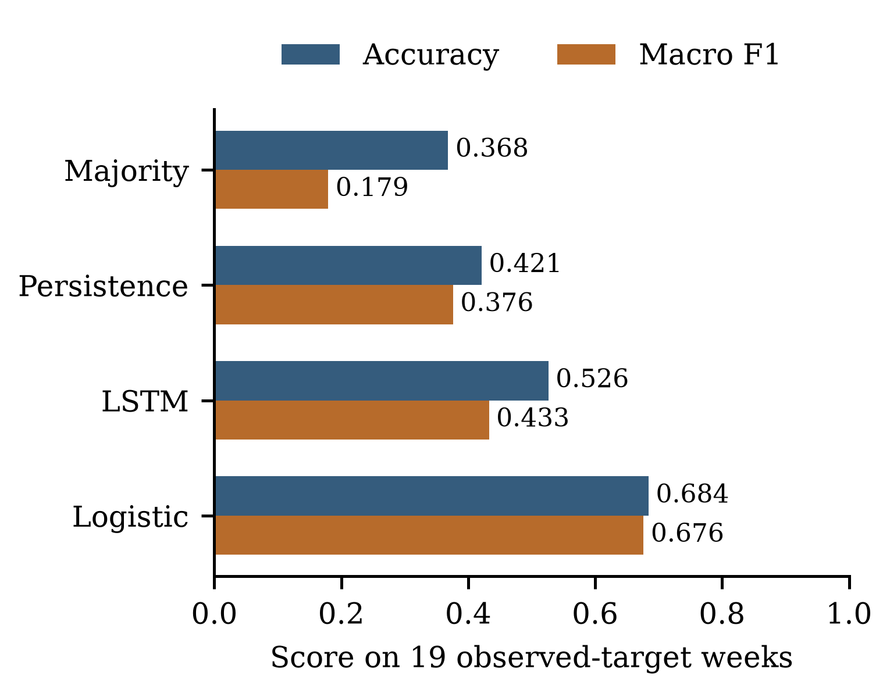
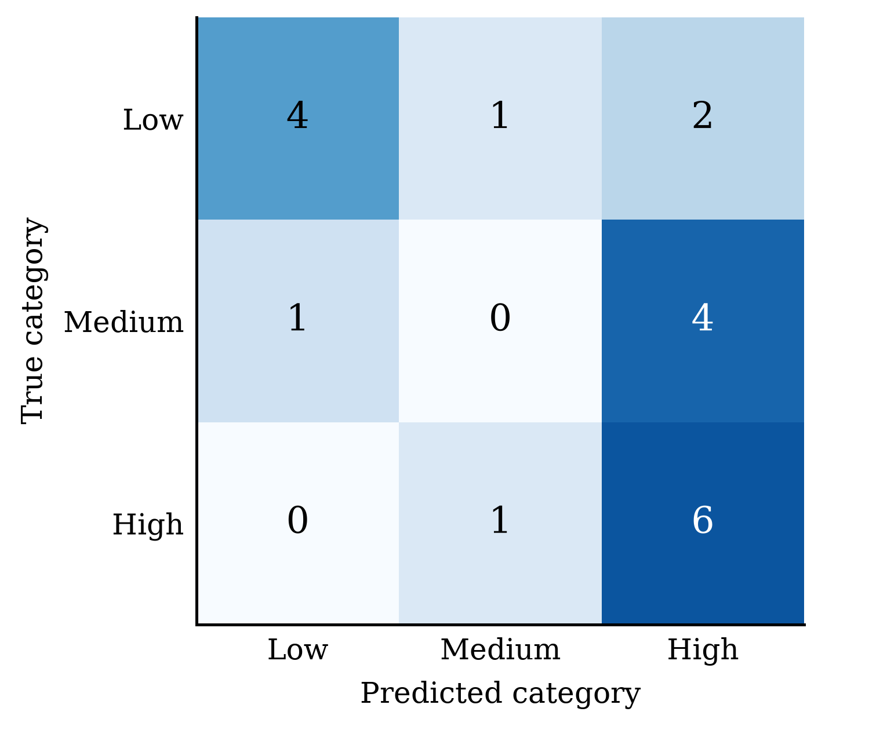

# CropSense AI: An Integrated Prototype for Leaf Disease Classification, Multispectral Vegetation Stress Assessment, and Pest Risk Prediction

Kuntala Shiva Sai Rahul | 23eg107e30@anurag.edu.in
Smrithi Thimmaraju | 23eg107e61@anurag.edu.in
Allva Asritha | 23eg107e05@anurag.edu.in
Dr. Ch. Padmini | padmini.ai@anurag.edu.in

School of Engineering, Anurag University, Hyderabad, India

## Abstract

Crop condition can be examined through leaf symptoms, canopy imagery, and weather-linked pest observations. These signals describe different processes, and combining them in an interface does not by itself establish a reliable measure of farm health. This paper presents CropSense AI, a dataset-based software prototype with three independently evaluated modules. A MobileNetV2 classifier identifies 38 crop-disease categories from RGB leaf images. A Random Forest assigns vegetation-stress categories from six statistics calculated from paired RGB and near-infrared tiles. A four-week long short-term memory model predicts a three-level pest-pressure target using weather and previous pest observations. The disease model is evaluated on laboratory-style PlantVillage images and non-laboratory PlantDoc photographs. Adaptation increases PlantDoc test accuracy from 30.95 to 55.95 percent on 252 images, while PlantVillage validation accuracy decreases from 98.10 to 96.83 percent. A retrained Random Forest baseline reaches 58.42 percent accuracy on 1,549 tiles under an inferred-field-grouped split, but correctly identifies only 23 of 280 healthy tiles. The pest model achieves 52.63 percent accuracy on 19 observed-target weeks, exceeding persistence at 42.11 percent and trailing logistic regression at 68.42 percent. Class-level errors, target construction, split design, and model identity are reported alongside aggregate scores. The dashboard combines module outputs only as an illustrative calculation because the source datasets do not share a labelled farm outcome. The results support transparent component evaluation while identifying substantial limits to field generalization and practical interpretation.

Keywords: crop disease classification; multispectral imagery; vegetation stress; pest risk; domain shift; model evaluation.

## I. Introduction

Crop-analysis software often brings together measurements that differ in scale and meaning. A leaf photograph may show a visible disease symptom. An aerial image describes patterns across a field. A weekly survey relates pest observations to weather at a particular location. Agricultural machine learning covers these and other tasks [1], while deep-learning research has expanded the range of image-based approaches [2]. A useful integrated prototype must explain the meaning and limits of each output before presenting a combined result.

Leaf classification provides a clear example of this problem. Mohanty et al. studied disease recognition using photographs collected under controlled conditions [3]. The PlantVillage repository made a substantial collection of healthy and diseased leaves available for research [4]. PlantDoc addresses the need for non-laboratory photographs [5]. Evaluation on both image settings can reveal errors that a laboratory validation score alone would conceal. An interface that displays high prediction confidence does not remove that difference between evaluation domains.

Canopy imagery provides a separate view of crop condition. Agriculture-Vision contains RGB and near-infrared imagery with agricultural anomaly annotations [6]. Such data support spatial analysis, but an anomaly annotation is not automatically an agronomist's diagnosis of stress severity. Pest forecasting adds another distinction: the target refers to a future observation, so preprocessing must respect what was available before that observation. Monitoring and forecasting systems have been studied together [7], and broader smart-farming research considers the integration of data and services [8]. Those studies motivate integration without establishing that unrelated datasets can validate one farm-level outcome.

CropSense AI examines these issues in a software-only prototype. The system implements leaf disease classification, multispectral vegetation-stress classification, and next-week pest-pressure classification. The modules use public datasets and run through one dashboard. Their training data describe different crops, places, and observation processes. We therefore evaluate the modules separately and identify the equal-weight combined score as an illustrative dashboard calculation.

The study asks three questions. First, how does adaptation using non-laboratory photographs change disease-classification performance in both image domains? Second, what does an inferred-field-grouped split reveal about the vegetation classifier's class-level errors? Third, how does the pest LSTM compare with persistence and logistic regression when evaluated by year? Our contribution is an implemented integration with explicit evaluation boundaries: a same-loader disease comparison, a grouped vegetation audit with error-based replacement decisions, and a causal pest comparison that retains the stronger simple baseline. These are application and evaluation contributions; the underlying learning algorithms are established methods.

Section II places the work in context. Sections III–V describe the system, methods, and data. Section VI reports the experiments, Section VII discusses their limits, and Section VIII concludes.

## II. Related Work

### A. Leaf disease recognition and image-domain differences

PlantVillage supports supervised recognition of crop-disease pairs [4]. Mohanty et al. report controlled-image experiments and discuss the difficulty of transfer beyond that setting [3]. PlantDoc introduces a non-laboratory dataset [5], making it relevant to evaluations where leaves appear with varied backgrounds and image quality. The distinction matters because a model may learn cues associated with image collection rather than features that remain useful in a field photograph.

Barbedo reviews challenges in automatic disease identification from visible-range images [9]. Ferentinos studies deep-learning models for plant disease detection and diagnosis [10], and Shrotriya et al. investigate plant-leaf classification and comparisons with conventional classification [11]. These works establish relevant disease-recognition contexts. Their reported results are not direct benchmarks for our implementation because the datasets, label mappings, and evaluation protocols differ.

MobileNetV2 uses inverted residuals and linear bottlenecks [12]. We use an existing MobileNetV2 checkpoint and adapt it while retaining its 38-class output contract. Image augmentation is a standard approach to increasing training variation [13]; our adaptation uses a fixed set of transformations rather than an augmentation search. Grad-CAM provides gradient-based localization of regions influential to a model prediction [14]. We include it as an inspection aid and do not interpret its heatmap as a validated segmentation of disease tissue.

### B. Vegetation indices and agricultural image annotations

Red and infrared combinations have a long history in vegetation monitoring [15]. NDVI has also been used to study ecological responses to environmental change [16]. These references support the use of spectral contrast as a vegetation descriptor. They do not imply that one NDVI value identifies a particular disease, nutrient deficiency, or soil condition.

Agriculture-Vision provides a related image-analysis setting with RGB/NIR inputs and agricultural anomaly patterns [6]. Our experiment uses its 2017 miniscale distribution and derives tile-level categories from mask coverage. This task differs from the dataset paper's agricultural pattern-segmentation task. Le et al. study crop response through a normalized difference latent heat index [17]. That paper motivates the broader crop-stress problem, but CropSense implements NDVI from RGB/NIR values, without thermal retrieval or latent-heat estimation.

### C. Pest prediction and evaluation of structured observations

Dong et al. study crop pest and disease monitoring with early forecasting [7]. CropSense addresses a narrower retrospective task using Akola cotton pest/weather observations. The LSTM architecture originates from work on learning dependencies in sequential data [18]. Its suitability for this task must be assessed against alternatives rather than assumed from the sequential input alone.

Roberts et al. explain why dependence in spatial and temporal data affects evaluation design [19]. Kapoor and Narayanan examine leakage and reproducibility failures in machine-learning-based science [20]. These concerns motivate year separation for pest observations, group separation for aerial tiles, and explicit records of preprocessing and model selection. A split can reduce one source of leakage while leaving other validity concerns unresolved.

TABLE I. RELATIONSHIP BETWEEN SELECTED PRIOR WORK AND CROPSENSE.

| Prior work | Relevant focus | Relationship to this study |
|---|---|---|
| Mohanty et al. [3]; PlantDoc [5] | Controlled and non-laboratory leaf images | Evaluate both domains; retain distinct split identities. |
| Shrotriya et al. [11] | Plant-leaf classification | Related disease study; no reproduced benchmark claimed. |
| Agriculture-Vision [6] | Aerial RGB/NIR anomaly analysis | Derive tile-level heuristic categories from masks. |
| Le et al. [17] | Latent-heat-index crop response | Context only; implemented index is NDVI. |
| Dong et al. [7] | Pest/disease monitoring and forecasting | Narrower cotton, single-location temporal experiment. |
| Roberts et al. [19]; Kapoor and Narayanan [20] | Dependence and leakage | Motivate grouped splits, causal inputs, and explicit caveats. |

Table I defines the relationship conservatively. The study does not claim that integration of agricultural signals is absent from prior literature. Its emphasis is the reliability of the particular implemented modules and the boundary between component evidence and a combined presentation.

## III. System Design

### A. Independent analysis paths

The Streamlit dashboard exposes three analysis paths. The disease path accepts a leaf photograph, resizes it to the model input dimensions, and displays the predicted crop-disease class, probabilities, and an optional Grad-CAM view. A leaf-image sanity warning is separate from the disease classifier. It is a heuristic check and can produce false positives; it does not add an unknown class to the model.

The canopy path accepts paired RGB and single-band NIR images. Matching spatial dimensions are required before computing the index. The dashboard displays the index image, six summary statistics, and the Random Forest classification. Manual statistics remain available for inspection. The pest path accepts a four-week sequence with the same feature order used during training and returns probabilities for low, medium, and high pressure.

Each module can be examined independently. This matters for both debugging and interpretation: an image classification should not appear more credible because another panel returns a favorable score. The modules do not exchange learned features, and no joint loss function is trained.

### B. Output mapping and composite presentation

The interface maps module outputs to bounded presentation scores. Let c be the disease model's maximum class probability. Its disease-health score D equals c if the predicted class is healthy and 1 − c otherwise. The vegetation score V is 1.0 for healthy, 0.5 for moderate stress, and 0.1 for severe stress. Pest probabilities produce the expected tier score P = 0p(low) + 0.5p(medium) + 1.0p(high). The combined display is

H = [D + V + (1 − P)] / 3.                                      (1)

These mappings come from the implemented dashboard. They are design choices, not calibrated measurements of crop health. In particular, D depends on the maximum probability and the selected class rather than the total probability of all healthy classes. The three component scores therefore do not share an empirically established scale. Equal weighting makes the calculation visible; it does not establish agronomic equivalence between its terms.

### C. Scope of the prototype

The implemented inputs are RGB photographs, RGB/NIR image pairs, and historical weather/scouting observations. No hyperspectral model, direct soil-condition estimator, or live sensor network is evaluated. The interface includes explanatory text and rule-based action messages, but these have not undergone agronomic outcome validation. We evaluate the software workflow and its component experiments.

## IV. Methodology

### A. Disease model adaptation

The disease model accepts a 224 × 224 RGB image and returns 38 class probabilities. Images are converted to RGB; transparent inputs are composited on white. Raw 0–255 values enter the saved graph, which already contains the MobileNetV2 rescaling operation. Applying a second external normalization would change the model's input contract.

The adaptation starts from the original checkpoint. PlantVillage training images and mapped PlantDoc training images are sampled with equal dataset weights. Batches contain 32 images. Augmentation uses horizontal flips, rotation with factor 0.08, zoom with factor 0.15, and contrast with factor 0.20. The MobileNetV2 backbone is frozen for two head-training epochs at an Adam learning rate of 0.0001 [21]. Fine-tuning then enables backbone layers from index 100 onward while leaving batch-normalization layers frozen. It runs for up to eight epochs at learning rate 0.00001, with 200 steps per epoch and gradient clipping.

Checkpoint selection uses macro F1 on the mapped PlantDoc validation subset. Validation-loss early stopping has patience three; the retained candidate is the checkpoint saved by the field-validation F1 criterion. This distinction avoids treating the stopping rule and the selection metric as interchangeable. The saved selection history reaches a best validation macro F1 of 0.560. Final comparisons use the locked selected artifact and the original artifact through the same image loader.

### B. NDVI features and heuristic labels

For corresponding red-channel and NIR values at pixel i, the implementation computes

NDVI(i) = [NIR(i) − R(i)] / [NIR(i) + R(i) + 0.00000001].          (2)

Both bands are converted to floating point before subtraction. Six statistics represent a tile: mean, standard deviation, minimum, maximum, 25th percentile, and 75th percentile. The Random Forest consumes these unscaled statistics in that order [22]. Masks are used to construct labels and are not passed as model inputs.

The severe category is assigned when coverage exceeds 5 percent for any of drydown, nutrient deficiency, or storm damage. Otherwise, the moderate category is assigned when coverage exceeds 2 percent for any of double planting, planter skip, endrow, or weed cluster. Remaining tiles are assigned healthy. A tile is excluded if either its water or waterway mask covers more than 15 percent. The severe rule has precedence, and the inequalities are strict. These definitions are task-specific proxies. They do not identify universal biological severity thresholds.

The input bands are raw 8-bit image values rather than independently validated surface reflectance. The calculation reproduces the dataset pipeline, but its physical interpretation depends on band encoding and calibration. The label healthy means that the selected annotation rules were not triggered; it does not establish absence of all possible crop stress.

### C. Grouped forest selection

Field groups are inferred from the filename prefix before the first underscore. A seeded group split allocates approximately 60 percent of tiles to training and 20 percent each to validation and test. The resulting tile counts differ from exact percentages because entire groups stay together. Assertions check that inferred identifiers are disjoint. The interpretation of those identifiers as independent fields still requires dataset-level confirmation.

The grouped baseline is a new fit of a 200-tree, class-balanced Random Forest. Six alternatives vary tree count, leaf size, feature sampling, depth, and class weights. A further validation sweep applies a healthy-class minimum-probability rule: if healthy is the highest-probability class but its probability is below the threshold, the higher-probability stress category is selected. Candidate decisions are eligible only when healthy recall does not decrease and severe-to-healthy errors do not increase relative to the validation baseline. Macro F1 selects among eligible decisions. Because both the forest configuration and decision threshold can change, the resulting comparison is not an isolated threshold ablation.

### D. Causal pest-pressure construction

Each weekly input contains maximum and minimum temperature, RH1 and RH2 relative humidity, rainfall, wind speed, sunshine hours, evaporation, and pest pressure. Pressure is derived from Jassid and Aphid counts. Each pest is min–max scaled using the 2005–2007 observations and clipped to the interval from zero to one. The maxima in the saved scaling configuration are 14.7 for Jassid and 207.0 for Aphid; both minima are zero. Pressure is the maximum of the two scaled values, requiring both values to be available.

Missing input pest values are forward-filled for at most four weeks within the same calendar-year series. Target pressure is calculated from the unfilled observations and is accepted only when both pest readings were observed. Low, medium, and high classes are defined by training-observation tertiles, with saved boundaries approximately 0.213688 and 0.322383. These are statistical categories, not economic pest-intervention thresholds.

For a target week, four preceding consecutive weeks form the input. A window crossing a year boundary or a gap in week numbers is rejected. No target-week weather or pest observation enters that input. The task therefore predicts next-week pressure from previous weather and scouting information; it is not a weather-only forecast. Requiring observed targets avoids treating interpolation as measured ground truth.

### E. LSTM and comparison models

Two LSTM configurations are compared: eight units with dropout 0.1 and sixteen units with dropout 0.3. Dropout is a training regularizer [23]. A normalization layer fitted only to training inputs is embedded in each saved graph, followed by the LSTM and a three-unit softmax layer. Adam uses learning rate 0.001 and gradient clipping. Training uses balanced class weights, batch size eight, no shuffled sequence order, and at most 60 epochs. Validation-loss early stopping has patience eight. Validation macro F1 selects the sixteen-unit model.

Three baselines use the same final target weeks. The majority baseline predicts the most frequent training class. Persistence assigns the class of the last available input pressure using the training thresholds. Logistic regression standardizes the flattened four-week inputs using training data and uses C = 0.1 with balanced class weights. Including these baselines tests whether a recurrent architecture adds value in this particular sample.

## V. Data and Implementation

### A. Dataset snapshots and partitions

The consumed PlantVillage distribution contains 54,305 images across 38 classes: 46,160 training and 8,145 validation images. These are snapshot-specific counts. They should not be substituted for the canonical counts in the original dataset papers. The largest class has 5,507 images and the smallest has 152, a ratio of approximately 36.2 to one. Fig. 1 shows the distribution by crop, aggregating disease and healthy categories within each crop.

The mapped PlantDoc distribution contributes 2,128 adaptation-training images, 532 validation images, and 252 test images. Exact decoded-image duplicates shared between training and test are excluded from training, and exact within-partition duplicates are removed. The audit does not establish absence of near duplicates or overlap with PlantVillage. The consumed mirror's counts also require reconciliation with the original PlantDoc distribution before making a dataset-version equivalence claim.

For vegetation analysis, 8,345 RGB/NIR pairs are processed and 8,308 remain after water exclusions. The grouped split contains 5,175 training, 1,584 validation, and 1,549 test tiles. The test partition contains 280 healthy, 569 moderate, and 700 severe tiles. Table II summarises the evaluation data and partition boundaries.

The pest source is the ICAR-CRIDA historical pest/weather database for Akola cotton, 2005–2009 [24]. Each pest query contains 260 weekly rows. The source records have 138 missing Jassid values and 141 missing Aphid values. Training uses 2005–2007, model selection uses 2008, and the final retrospective comparison uses 2009. The saved evaluation has 12 validation windows and 19 test windows; the latter include seven low, five medium, and seven high targets. Missing weeks are not interpreted as zero pest presence.

TABLE II. DATA PARTITIONS AND THEIR INTERPRETATION.

| Data path | Training | Validation | Final comparison |
|---|---|---|---|
| PlantVillage snapshot | 46,160 images | 8,145 images | Historical laboratory validation benchmark; no separate test partition. |
| Mapped PlantDoc mirror | 2,128 images | 532 images | 252 test images; test had been inspected previously. |
| RGB/NIR tiles | 5,175 tiles | 1,584 tiles | 1,549 tiles; disjoint inferred identifiers. |
| Akola pest/weather | 2005–2007 | 2008; 12 windows | 2009; 19 observed-target windows. |

### B. Implementation and model identity

TensorFlow/Keras implements the neural models; scikit-learn implements the forests and logistic regression [25]. The application uses Streamlit for interaction and Plotly for reporting. Saved model contracts define input shapes, feature order, class order, and preprocessing. Table III records the principal settings. Training environments are recorded separately from the pinned Python 3.12 application environment because training and deployment need not use identical package stacks.

TABLE III. INPUT CONTRACTS AND PRINCIPAL MODEL SETTINGS.

| Component | Input contract | Principal settings |
|---|---|---|
| Disease CNN | 224 × 224 × 3; raw RGB | MobileNetV2; 38 outputs; 2 head epochs, up to 8 fine-tuning epochs; field-validation F1 selection. |
| Grouped RF baseline | Six unscaled NDVI statistics | 200 trees; balanced classes; seed 42. |
| Threshold candidate | Same six statistics | 400 trees; balanced subsamples; leaf minimum 4; depth 20; healthy minimum 0.45. |
| Pest LSTM | 4 weeks × 9 features | 16 units; dropout 0.3; training-fitted normalization; 3 outputs. |
| Pest logistic regression | Flattened 36 features | Training-fitted standardization; C = 0.1; balanced classes. |

The release contains the adapted CNN and the revised LSTM. The older Random Forest remains in the release because proposed grouped candidates were not accepted for replacement after inspection of final-test errors. Consequently, the grouped-baseline results in this paper describe a retrained experimental model, not a direct evaluation of the exact released forest. Model hashes distinguish these artifacts and prevent a fresh training run from being mistaken for a re-evaluation of the release.

### C. Evidence and functional verification

The project retains result summaries, per-class reports, confusion counts, training histories, selection records, environment descriptions, and an artifact manifest. The grouped-tile split manifest is available locally. Some sample-level exports and the complete disease and pest split manifests are absent from the local evidence snapshot, although the notebooks contain their export procedures. Full reproduction therefore requires restoring those records or rerunning the documented data preparation against identified source snapshots.

Functional dashboard checks cover module navigation, image-pair validation, state updates, and composite scenarios. These checks establish implementation behavior. They do not measure farmer task performance, usability, or improved crop outcomes. No inference-latency or load benchmark is reported here.

## VI. Experimental Evaluation and Results

### A. Metrics and comparison rules

Accuracy is the fraction of correct predictions. For each class, precision is TP/(TP + FP), recall is TP/(TP + FN), and F1 is their harmonic mean. Macro F1 averages class F1 values equally [26]. Undefined class-level ratios are assigned zero in the exported reports. Disease results report macro F1 over the 27 classes present in the PlantDoc test, whereas PlantVillage results cover all 38 classes. The vegetation and pest comparisons each use all three classes.

Models are compared only on matching partitions and targets. The historical vegetation result from a random-tile split is not used to quantify improvement under grouping. Likewise, the revised observed-target pest task is not directly compared with older experiments using interpolated targets. No statistical-significance claim is made. The pest windows overlap in time, and tile/image dependence may remain, so treating every sample as independent would require further justification.

TABLE IV. COMPONENT RESULTS ON THEIR SPECIFIED PARTITIONS.

| Model / partition | n | Accuracy (%) | Macro F1 |
|---|---:|---:|---:|
| Original CNN / PlantDoc test | 252 | 30.95 | 0.297 |
| Adapted CNN / PlantDoc test | 252 | 55.95 | 0.552 |
| Original CNN / PlantVillage validation | 8,145 | 98.10 | 0.977 |
| Adapted CNN / PlantVillage validation | 8,145 | 96.83 | 0.956 |
| Retrained RF / grouped tile test | 1,549 | 58.42 | 0.474 |
| Threshold candidate / same tile test | 1,549 | 57.84 | 0.477 |
| Majority / 2009 observed targets | 19 | 36.84 | 0.179 |
| Persistence / same 2009 targets | 19 | 42.11 | 0.376 |
| Selected LSTM / same 2009 targets | 19 | 52.63 | 0.433 |
| Logistic regression / same 2009 targets | 19 | 68.42 | 0.676 |

### B. Disease adaptation and remaining field errors

The adapted CNN correctly classifies 141 of 252 PlantDoc test images, compared with 78 for the original checkpoint. Accuracy improves by 25.00 percentage points, and present-class macro F1 increases from 0.297 to 0.552. Fig. 2 places these results beside laboratory validation. The corresponding PlantVillage accuracy decreases by approximately 1.26 percentage points. Adaptation improves the measured field benchmark while introducing a laboratory-validation tradeoff.

The improvement is not uniform across classes. Tomato late-blight recall falls from 0.80 to 0.20 on ten test images. This subgroup is small, but its direction matters when assessing a replacement checkpoint. An aggregate gain cannot establish improvement for every disease. Macro F1 over all 38 output classes is 0.211 for the original and 0.392 for the adapted model; these values differ from the present-class figures because eleven classes have no test support.

The locked release model's result is distinguished from a fresh retraining that reached 55.16 percent on the same field benchmark. The latter is a different artifact and is not substituted into Table IV. This distinction makes the reported result a statement about a specific saved checkpoint rather than a guarantee that retraining will yield the same value.

### C. Vegetation classification and replacement decisions

The grouped Random Forest baseline reaches 58.42 percent accuracy and macro F1 0.474. Fig. 3 shows the confusion counts. Healthy recall is only 23/280, or 8.21 percent. Most healthy tiles are assigned a stress category. Of 700 severe tiles, 74 are classified healthy, a severe-to-healthy rate of 10.57 percent. These two error patterns are obscured by overall accuracy.

The validation-selected threshold candidate has test macro F1 0.477 and healthy recall 29/280, or 10.36 percent. However, severe-to-healthy errors increase to 81/700, or 11.57 percent. On validation, this candidate had preserved the baseline's 26/613 severe-to-healthy errors while increasing healthy recall from 42/318 to 56/318. Its validation tradeoff did not carry over unchanged to the test partition. The candidate was not promoted.

Successive vegetation experiments inspected the same test partition. Validation selection within the final notebook does not erase that development history. The replacement decision is therefore reported as an audited engineering choice, and the test should not be described as untouched throughout development. A new independently grouped dataset would be needed for a stronger external assessment.

### D. Pest prediction against simpler baselines

The selected LSTM correctly classifies 10/19 target weeks. Persistence classifies 8/19 correctly, and the majority baseline classifies 7/19. Logistic regression is stronger at 13/19, with macro F1 0.676 compared with the LSTM's 0.433. Fig. 4 reports all four models on the same observations. The required LSTM architecture is retained in the prototype, but the comparison does not support choosing it on predictive performance alone.

The LSTM confusion matrix in Fig. 5 exposes a further weakness. It correctly identifies four of seven low and six of seven high targets, but none of the five medium targets. Medium-class recall and F1 are zero. A 52.63 percent accuracy headline would conceal this failure to recover an intermediate category. These errors warrant examining the pressure representation and class boundaries before treating the output as a reliable tiered warning.

Each correct prediction changes accuracy by about 5.26 percentage points in this test. The observed differences should therefore be interpreted as a small retrospective comparison, not evidence of stable performance across years or regions. The 2009 source season was also inspected in earlier project work, even though the revised training run excludes it from fitting and early stopping.

## VII. Discussion and Limitations

### A. What the integration establishes

CropSense shows that independently trained image, spectral-summary, and sequence models can be operated through one interface while retaining their separate inputs and reports. The implementation makes it possible to inspect a component prediction and its limitations without inferring a shared underlying field. Keeping the inputs separate helps interpretation, but does not demonstrate better agronomic decisions than using the modules separately. Such a claim would require a comparative user or field study.

The experiments also show why module-level evidence should remain visible. Adaptation reduces one measured disease-domain gap but does not remove it. The vegetation classifier has low healthy recall. The LSTM misses the medium class and is weaker than logistic regression. Combining those outputs into one number cannot compensate for their individual errors.

### B. Data and evaluation validity

The disease evaluation uses a closed set of crop-disease classes. An unfamiliar crop, non-leaf object, or unrepresented disease may still receive a confident class. The auxiliary sanity warning is not a validated open-set detector. Exact-image duplicate checks reduce one overlap mechanism but do not establish specimen-level independence, near-duplicate removal, or absence of cross-dataset reuse. Historical inspection of the test benchmark further limits claims of prospective generalization.

The vegetation categories depend on selected anomaly masks and coverage thresholds. Spectral summaries discard spatial arrangement, so tiles with different structures can produce similar feature vectors. The field groups are inferred from filenames rather than independently verified acquisition metadata. Water exclusion also changes the population to which the results apply. These limitations concern target validity and sample structure, not only classifier choice.

For pest prediction, the record covers one location and five calendar years, with sparse observations for both pests. Forward filling preserves temporal direction but can make the input pressure stale. The statistical tertiles do not identify intervention thresholds. Observed-target filtering changes which weeks are evaluated, and overlapping windows are dependent. More seasons, locations, and complete scouting records are needed before extending the result to new farming settings.

### C. Interpretation of confidence and fusion

Softmax probabilities are used for display and score construction; probability calibration is not evaluated. A high model probability should not be reported as the chance that a diagnosis is correct. Grad-CAM indicates influence on a prediction, without establishing biological causality. The NDVI-derived score is a category mapping, while the pest score is an expectation over statistical classes. Their arithmetic combination has no validated interpretation as yield, damage, or probability of crop failure.

The combined score lacks a labelled joint test set because the source datasets do not identify the same farm outcome. There is consequently no composite accuracy, confusion matrix, or comparison with a learned fusion model. Creating such a benchmark would require aligned measurements and a clearly defined outcome, collected at compatible places and times. Until then, individual reports are the appropriate basis for assessing model behavior.

### D. Reproducibility and practical limits

Recorded artifact hashes and saved reports support auditing the presented results. They do not by themselves reproduce data preparation, especially where local split or sample-level exports are incomplete. Dataset access, source-mirror identity, split membership, and preprocessing must all be recoverable. Training randomness and the difference between locked-model verification and fresh retraining should remain explicit.

The present work includes functional application checks rather than a field trial. It does not establish reduced crop loss, lower treatment cost, improved yield, farmer adoption, or safety of action messages. The prototype should therefore be used for research inspection and demonstration while its models and advice undergo further validation.

## VIII. Conclusion and Future Work

CropSense AI integrates leaf disease classification, RGB/NIR vegetation analysis, and next-week pest-pressure classification in a dataset-based dashboard. The component experiments answer the study's questions with different outcomes. Disease adaptation improves accuracy on the inspected PlantDoc benchmark while reducing laboratory validation performance. Grouped vegetation evaluation exposes weak healthy recall and a replacement candidate with more severe-to-healthy errors. The pest LSTM exceeds persistence on 19 target weeks but trails logistic regression and fails to identify the medium class.

These findings support reporting class-level errors and evaluation boundaries alongside headline metrics. The equal-weight dashboard score remains illustrative because no joint farm-level outcome is available. Future work should prioritize reconciled dataset provenance, complete split records, verified field grouping, agronomist-reviewed stress labels, and additional pest seasons and locations. A linked field dataset is needed before learning fusion weights or evaluating the combined score as a practical crop-health measure.

## Acknowledgement

The authors thank Dr. Ch. Padmini, Assistant Professor, and the School of Engineering, Anurag University, for guidance and support during the mini project.

## References

[1] K. Liakos, P. Busato, D. Moshou, S. Pearson, and D. Bochtis, “Machine Learning in Agriculture: A Review,” Sensors, vol. 18, no. 8, pp. 2674, 2018, doi: 10.3390/s18082674. [Source](https://doi.org/10.3390/s18082674)

[2] A. Kamilaris, and F. X. Prenafeta-Boldú, “Deep learning in agriculture: A survey,” Computers and Electronics in Agriculture, vol. 147, pp. 70–90, 2018, doi: 10.1016/j.compag.2018.02.016. [Source](https://doi.org/10.1016/j.compag.2018.02.016)

[3] S. P. Mohanty, D. P. Hughes, and M. Salathé, “Using Deep Learning for Image-Based Plant Disease Detection,” Frontiers in Plant Science, vol. 7, Art. no. 1419, 2016, doi: 10.3389/fpls.2016.01419. [Source](https://doi.org/10.3389/fpls.2016.01419)

[4] D. P. Hughes and M. Salathé, “An open access repository of images on plant health to enable the development of mobile disease diagnostics,” arXiv:1511.08060, 2015. [Source](https://arxiv.org/abs/1511.08060)

[5] D. Singh, N. Jain, P. Jain, P. Kayal, S. Kumawat, and N. Batra, “PlantDoc: A dataset for visual plant disease detection,” arXiv:1911.10317, 2019. [Source](https://arxiv.org/abs/1911.10317)

[6] M. T. Chiu et al., “Agriculture-Vision: A large aerial image database for agricultural pattern analysis,” in Proc. IEEE/CVF CVPR, 2020. [Source](https://arxiv.org/abs/2001.01306)

[7] Y. Dong et al., “Automatic System for Crop Pest and Disease Dynamic Monitoring and Early Forecasting,” IEEE Journal of Selected Topics in Applied Earth Observations and Remote Sensing, vol. 13, pp. 4410–4418, 2020, doi: 10.1109/JSTARS.2020.3013340. [Source](https://doi.org/10.1109/JSTARS.2020.3013340)

[8] S. Wolfert, L. Ge, C. Verdouw, and M. J. Bogaardt, “Big Data in Smart Farming – A review,” Agricultural Systems, vol. 153, pp. 69–80, 2017, doi: 10.1016/j.agsy.2017.01.023. [Source](https://doi.org/10.1016/j.agsy.2017.01.023)

[9] J. G. A. Barbedo, “A review on the main challenges in automatic plant disease identification based on visible range images,” Biosystems Engineering, vol. 144, pp. 52–60, 2016, doi: 10.1016/j.biosystemseng.2016.01.017. [Source](https://doi.org/10.1016/j.biosystemseng.2016.01.017)

[10] K. P. Ferentinos, “Deep learning models for plant disease detection and diagnosis,” Computers and Electronics in Agriculture, vol. 145, pp. 311–318, 2018, doi: 10.1016/j.compag.2018.01.009. [Source](https://doi.org/10.1016/j.compag.2018.01.009)

[11] A. Shrotriya, A. Kumar Sharma, S. Prabhu, and A. Kumar Bairwa, “An Approach Toward Classifying Plant-Leaf Diseases and Comparisons With the Conventional Classification,” IEEE Access, vol. 12, pp. 117379–117398, 2024, doi: 10.1109/ACCESS.2024.3411013. [Source](https://doi.org/10.1109/ACCESS.2024.3411013)

[12] M. Sandler, A. Howard, M. Zhu, A. Zhmoginov, and L.-C. Chen, “MobileNetV2: Inverted residuals and linear bottlenecks,” in Proc. IEEE/CVF CVPR, 2018, pp. 4510–4520. [Source](https://arxiv.org/abs/1801.04381)

[13] C. Shorten, and T. M. Khoshgoftaar, “A survey on Image Data Augmentation for Deep Learning,” Journal of Big Data, vol. 6, no. 1, Art. no. 60, 2019, doi: 10.1186/s40537-019-0197-0. [Source](https://doi.org/10.1186/s40537-019-0197-0)

[14] R. R. Selvaraju et al., “Grad-CAM: Visual explanations from deep networks via gradient-based localization,” arXiv:1610.02391, 2016, revised 2019. [Source](https://arxiv.org/abs/1610.02391)

[15] C. J. Tucker, “Red and photographic infrared linear combinations for monitoring vegetation,” Remote Sensing of Environment, vol. 8, no. 2, pp. 127–150, 1979, doi: 10.1016/0034-4257(79)90013-0. [Source](https://doi.org/10.1016/0034-4257(79)90013-0)

[16] N. Pettorelli et al., “Using the satellite-derived NDVI to assess ecological responses to environmental change,” Trends in Ecology & Evolution, vol. 20, no. 9, pp. 503–510, 2005, doi: 10.1016/j.tree.2005.05.011. [Source](https://doi.org/10.1016/j.tree.2005.05.011)

[17] M. Son Le, Y. A. Liou, and M. T. Pham, “Crop Response to Disease and Water Scarcity Quantified by Normalized Difference Latent Heat Index,” IEEE Access, vol. 11, pp. 55938–55946, 2023, doi: 10.1109/ACCESS.2023.3283033. [Source](https://doi.org/10.1109/ACCESS.2023.3283033)

[18] S. Hochreiter, and J. Schmidhuber, “Long Short-Term Memory,” Neural Computation, vol. 9, no. 8, pp. 1735–1780, 1997, doi: 10.1162/neco.1997.9.8.1735. [Source](https://doi.org/10.1162/neco.1997.9.8.1735)

[19] D. R. Roberts et al., “Cross‐validation strategies for data with temporal, spatial, hierarchical, or phylogenetic structure,” Ecography, vol. 40, no. 8, pp. 913–929, 2017, doi: 10.1111/ecog.02881. [Source](https://doi.org/10.1111/ecog.02881)

[20] S. Kapoor, and A. Narayanan, “Leakage and the reproducibility crisis in machine-learning-based science,” Patterns, vol. 4, no. 9, Art. no. 100804, 2023, doi: 10.1016/j.patter.2023.100804. [Source](https://doi.org/10.1016/j.patter.2023.100804)

[21] D. P. Kingma and J. Ba, “Adam: A method for stochastic optimization,” in Proc. ICLR, 2015. [Source](https://arxiv.org/abs/1412.6980)

[22] L. Breiman, “Random Forests,” Machine Learning, vol. 45, no. 1, pp. 5–32, 2001, doi: 10.1023/A:1010933404324. [Source](https://doi.org/10.1023/A:1010933404324)

[23] N. Srivastava, G. Hinton, A. Krizhevsky, I. Sutskever, and R. Salakhutdinov, “Dropout: A simple way to prevent neural networks from overfitting,” J. Mach. Learn. Res., vol. 15, pp. 1929–1958, 2014. [Source](https://jmlr.org/papers/v15/srivastava14a.html)

[24] ICAR-CRIDA, “Historical data of pest and weather: Cotton, Akola, Jassid and Aphid, 2005–2009,” Pest and Weather Database, accessed Oct. 10, 2026. [Source](http://icar-crida.res.in:8080/naip/Servlet1.jsp)

[25] F. Pedregosa et al., “Scikit-learn: Machine learning in Python,” J. Mach. Learn. Res., vol. 12, pp. 2825–2830, 2011. [Source](https://jmlr.org/papers/v12/pedregosa11a.html)

[26] M. Sokolova, and G. Lapalme, “A systematic analysis of performance measures for classification tasks,” Information Processing & Management, vol. 45, no. 4, pp. 427–437, 2009, doi: 10.1016/j.ipm.2009.03.002. [Source](https://doi.org/10.1016/j.ipm.2009.03.002)
